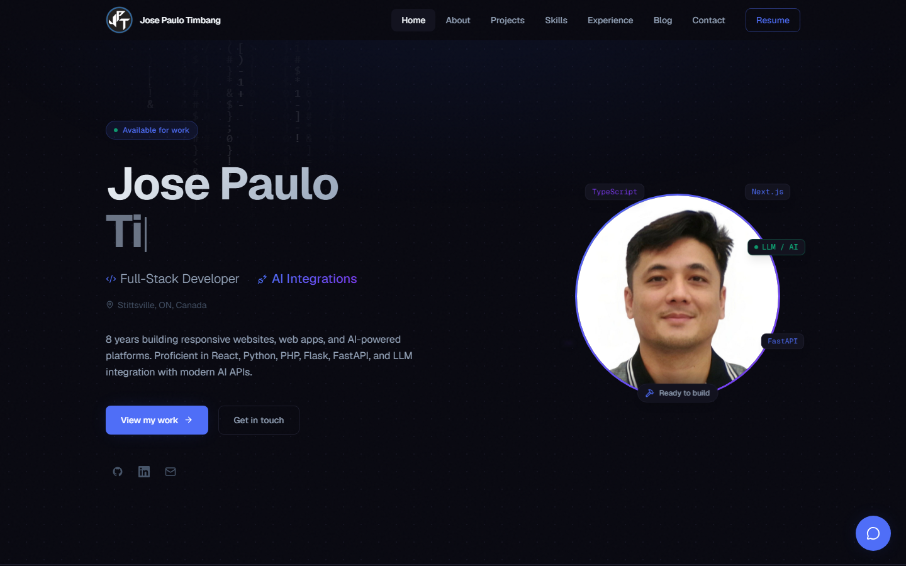
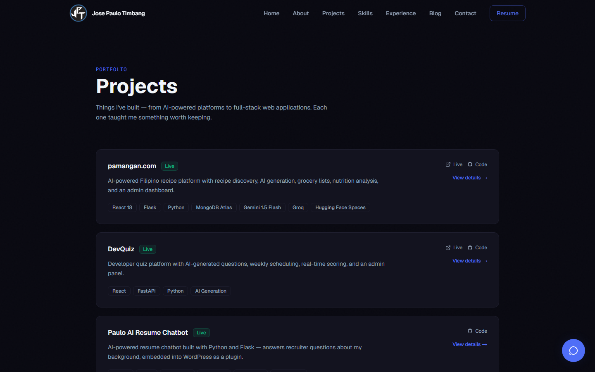
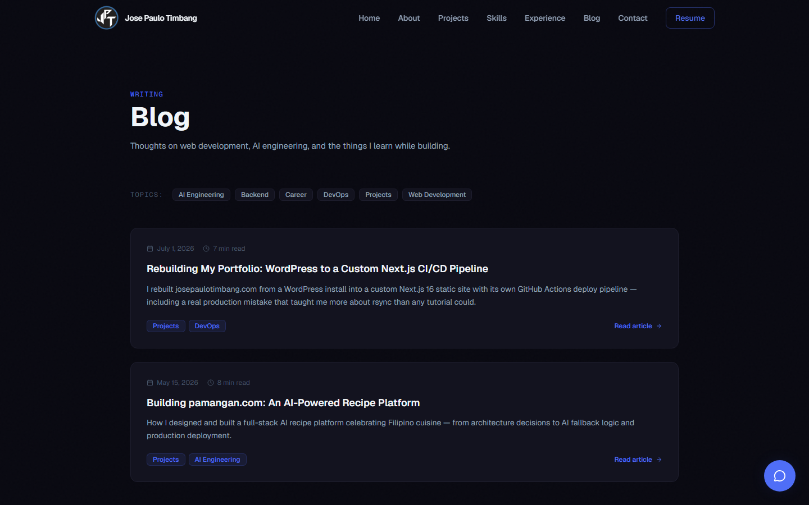
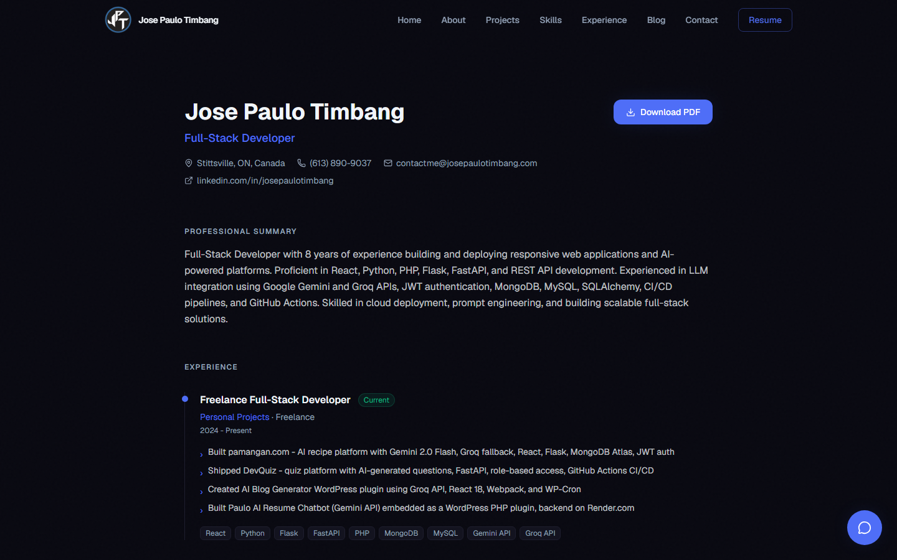

# josepaulotimbang.com

A personal portfolio and blog site for a full-stack developer, built as a decoupled Next.js frontend and a CodeIgniter 4 REST API, with an AI-powered chat assistant for visitors.

**Live site:** [josepaulotimbang.com](https://josepaulotimbang.com)

---

## Screenshots

| Home | Projects |
|---|---|
|  |  |

| Blog | Resume |
|---|---|
|  |  |

---

## Introduction

josepaulotimbang.com was rebuilt from a WordPress site into a custom Next.js + CodeIgniter 4 stack to get full control over performance, design, and content structure without a CMS's overhead.

The frontend is statically exported and deployed to shared hosting. All live content (projects, skills, experience, blog posts, resume) is defined in the frontend source and baked into the static build. A CodeIgniter 4 REST API with a JWT-protected admin surface is also included in the repo, but **the live site does not call it yet** — see [Backend status](#backend-status). A separate AI chatbot service lets visitors ask questions about the owner's skills and experience directly from the site.

---

## Use Cases

- **Recruiter or hiring manager** — browses projects, skills, and work experience, then reads the resume page before reaching out.
- **Visitor curiosity** — opens the AI chat widget and asks "What are your skills?" or "Can you build WordPress sites?" instead of reading the whole site.
- **Blog reader** — reads a technical write-up (e.g. the WordPress-to-Next.js rebuild post), browses tags, with related posts suggested at the end.
- **Recruiter (offline)** — downloads the PDF resume from the resume page; it is generated from the same data as the page.
- **Site owner** — edits content in the frontend source (e.g. `app/resume/page.tsx`, `app/projects/`, `lib/blog.ts`) and pushes to `main` to redeploy.
- **Prospective client** — submits a project inquiry through the contact form, delivered by email without needing a backend mail server.

---

## Features

- **Static-Exported Frontend** — Next.js App Router pages (`home`, `about`, `projects`, `skills`, `experience`, `blog`, `resume`, `contact`) built as static HTML for cheap shared hosting
- **AI Resume Chatbot** — floating chat widget backed by an external AI service; answers questions about skills, experience, and projects with conversation history and clickable link/email formatting
- **Chat Spam Prevention** — per-message length cap, a send cooldown, and a per-session message limit protect the chatbot from abuse
- **Blog** — Markdown posts with categories, tags, and related-posts lookup, defined in `lib/blog.ts` and rendered at build time
- **Downloadable Resume PDF** — `npm run resume:pdf` builds the PDF from the resume page so the download never drifts from the site
- **Projects & Experience** — structured project entries (tech stack, live/GitHub links, featured flag) and work history with detail pages per project
- **JWT-Protected Admin API (not yet connected)** — single-admin login issues a signed JWT; protected routes cover messages, projects, posts, skills, and experience
- **Contact Form** — client-side form posts directly to Web3Forms, so no backend mail service is required
- **SEO Basics** — dynamic `sitemap.ts` and `robots.ts`, plus per-page metadata
- **Health Check (API)** — `GET /health` endpoint for uptime monitoring

---

## Tech Stack

### Frontend
| Technology | Purpose |
|---|---|
| Next.js 16 (App Router) | Static site generation and routing |
| React 19 | UI framework |
| TypeScript | Type safety |
| Tailwind CSS 4 | Styling and responsive design |
| Framer Motion | Animations and transitions |
| lucide-react | Icon set |
| marked | Markdown rendering for blog content |
| Web3Forms | Contact form email delivery (no backend needed) |

### Backend
| Technology | Purpose |
|---|---|
| CodeIgniter 4 | REST API framework |
| PHP 8.1+ | Runtime |
| firebase/php-jwt | JWT issuing and verification |
| MySQLi | Database driver |

### Database
| Technology | Purpose |
|---|---|
| MySQL | Primary database (hosted on Hostinger) |

### AI
| Technology | Purpose |
|---|---|
| paulo-ai-chatbot (external service) | Standalone chatbot API the frontend calls for the AI resume assistant |

### Infrastructure
| Technology | Purpose |
|---|---|
| Hostinger | Shared hosting for the static frontend export and the PHP API |
| GitHub Actions | CI/CD — builds and deploys the frontend on push to `main` |
| rsync over SSH | Frontend static export deployment to Hostinger `public_html` |

---

## Project Structure

```
josepaulotimbang.com/
├── backend/
│   ├── app/
│   │   ├── Config/
│   │   │   ├── App.php          # Base URL, environment settings
│   │   │   ├── Cors.php         # Allowed origins, headers, methods
│   │   │   ├── Database.php     # DB connection config
│   │   │   ├── Filters.php      # Registers the jwt filter
│   │   │   └── Routes.php       # All API route definitions
│   │   ├── Controllers/Api/
│   │   │   ├── AuthController.php        # Single-admin login, issues JWT
│   │   │   ├── ContactController.php     # Store + admin inbox for messages
│   │   │   ├── ExperienceController.php  # Work experience CRUD
│   │   │   ├── PostController.php        # Blog posts, categories, tags
│   │   │   ├── ProjectController.php     # Projects CRUD
│   │   │   └── SkillController.php       # Skills CRUD
│   │   ├── Filters/
│   │   │   └── JwtFilter.php    # Verifies JWT on /v1/admin/* routes
│   │   ├── Helpers/
│   │   │   └── response_helper.php  # api_success() / api_error() envelopes
│   │   └── Models/
│   │       ├── CategoryModel.php
│   │       ├── ContactModel.php
│   │       ├── ExperienceModel.php
│   │       ├── PostModel.php
│   │       ├── ProjectModel.php
│   │       └── SkillModel.php
│   ├── public/
│   │   └── index.php            # Front controller
│   └── composer.json
├── frontend/
│   ├── app/
│   │   ├── about/page.tsx
│   │   ├── blog/
│   │   │   ├── page.tsx         # Blog index
│   │   │   └── [slug]/page.tsx  # Single post
│   │   ├── contact/
│   │   │   ├── page.tsx
│   │   │   └── ContactForm.tsx  # Web3Forms submission
│   │   ├── experience/page.tsx
│   │   ├── projects/
│   │   │   ├── page.tsx
│   │   │   └── [slug]/page.tsx
│   │   ├── resume/page.tsx
│   │   ├── skills/page.tsx
│   │   ├── layout.tsx
│   │   ├── page.tsx              # Home page
│   │   ├── robots.ts
│   │   └── sitemap.ts
│   ├── components/
│   │   ├── layout/
│   │   │   ├── Header.tsx
│   │   │   ├── Footer.tsx
│   │   │   └── Nav.tsx
│   │   └── ui/
│   │       ├── ChatWidget.tsx    # AI chatbot widget with spam prevention
│   │       ├── AnimateIn.tsx
│   │       ├── Badge.tsx
│   │       ├── Button.tsx
│   │       ├── CountUp.tsx
│   │       ├── GlitchLabel.tsx
│   │       ├── HeroPhoto.tsx
│   │       ├── HeroRipple.tsx
│   │       ├── MatrixRain.tsx
│   │       ├── ParallaxDots.tsx
│   │       └── TypeWriter.tsx
│   ├── lib/
│   │   ├── api.ts               # Fetch wrapper for the backend API (not used yet)
│   │   ├── blog.ts               # Blog posts and helpers
│   │   └── utils.ts
│   ├── public/
│   │   └── jose-paulo-timbang-resume.pdf  # Generated by npm run resume:pdf
│   ├── scripts/resume/
│   │   ├── build-docx.mjs       # Builds the resume .docx from app/resume/page.tsx
│   │   └── export-pdf.ps1       # Converts it to PDF with Microsoft Word
│   └── package.json
├── database/
│   └── migrations/
│       ├── 001_create_tables.sql
│       └── 002_seed_data.sql
├── public_html/
│   └── .htaccess                # HTTPS redirect, SPA fallback, security headers
└── .github/
    └── workflows/
        └── deploy-frontend.yml  # Build and deploy frontend to Hostinger on push
```

---

## Getting Started

### Prerequisites

- Node.js 20+
- PHP 8.1+ and Composer
- MySQL database

### 1. Clone the repository

```bash
git clone https://github.com/JPTWeb01/josepaulotimbang.com.git
cd josepaulotimbang.com
```

### 2. Database setup

```bash
mysql -u root -p < database/migrations/001_create_tables.sql
mysql -u root -p portfolio_db < database/migrations/002_seed_data.sql
```

### 3. Backend setup

```bash
cd backend
composer install
cp .env.example .env
```

Edit `.env` with your database credentials and JWT secret (see Environment Variables section), then run:

```bash
php spark serve
```

The API will be available at `http://localhost:8000`.

### 4. Frontend setup

```bash
cd frontend
npm install
cp .env.example .env.local
```

Edit `.env.local` (see Environment Variables section), then run:

```bash
npm run dev
```

The site will be available at `http://localhost:3000`.

---

## Environment Variables

### Backend — `backend/.env`

```env
CI_ENVIRONMENT = development

app.baseURL = 'http://localhost:8000'
app.forceGlobalSecureRequests = false

database.default.hostname = localhost
database.default.database = portfolio_db
database.default.username = root
database.default.password =
database.default.DBDriver = MySQLi
database.default.DBPrefix =
database.default.port = 3306

# JWT
JWT_SECRET = your-super-secret-jwt-key-change-this-in-production
JWT_TTL = 86400

# CORS — comma-separated allowed origins
CORS_ORIGINS = http://localhost:3000,https://josepaulotimbang.com

# Contact — email notifications (optional)
MAIL_FROM = noreply@josepaulotimbang.com
MAIL_TO = contactme@josepaulotimbang.com
```

| Variable | Purpose |
|---|---|
| `app.baseURL` | Base URL used to build absolute links and the JWT `iss` claim |
| `database.default.*` | MySQL connection settings |
| `JWT_SECRET` | Secret used to sign JWT tokens — keep this random and private |
| `JWT_TTL` | Token lifespan in seconds (86400 = 24 hours) |
| `CORS_ORIGINS` | Comma-separated origins allowed to call the API |
| `ADMIN_EMAIL` / `ADMIN_PASSWORD` | Single-admin login credentials checked by `AuthController::login` (password stored as a bcrypt hash) |

### Frontend — `frontend/.env.local`

```env
# API base URL (no trailing slash)
# Local dev:   http://localhost:8000/v1
# Production:  https://api.josepaulotimbang.com/v1
NEXT_PUBLIC_API_URL=http://localhost:8000/v1
NEXT_PUBLIC_WEB3FORMS_KEY=your-web3forms-access-key
```

| Variable | Purpose |
|---|---|
| `NEXT_PUBLIC_API_URL` | Base URL for all CodeIgniter API requests |
| `NEXT_PUBLIC_WEB3FORMS_KEY` | Access key for Web3Forms contact form submissions |
| `NEXT_PUBLIC_CHATBOT_URL` | Base URL for the AI chatbot service (defaults to the hosted `paulo-ai-chatbot` instance) |

---

## Updating the Resume PDF

The resume page (`frontend/app/resume/page.tsx`) is the single source of truth. After editing it, regenerate the downloadable PDF and commit it:

```bash
cd frontend
npm run resume:pdf   # Windows + Microsoft Word required for the PDF step
git add public/jose-paulo-timbang-resume.pdf
```

`npm run resume:docx` builds only the Word file (into `scripts/resume/out/`, gitignored) and works on any OS.

---

## Deployment Workflow

### Frontend — GitHub Actions → Hostinger

Defined in `.github/workflows/deploy-frontend.yml`.

**Trigger:** Push to `main` affecting `frontend/**`, or the workflow file itself.

**Steps:**
1. Checkout code
2. Setup Node.js 20 with npm cache
3. `npm ci` — install dependencies
4. `npm run build` — Next.js static export with `NEXT_PUBLIC_API_URL` and `NEXT_PUBLIC_WEB3FORMS_KEY` injected
5. Deploy `frontend/out/` to Hostinger via `rsync` over SSH (excludes `/devquiz` and `/wordpress` so sibling apps on the same hosting account aren't touched)

**Required GitHub Secrets:**

| Secret | Value |
|---|---|
| `SSH_PRIVATE_KEY` | Private SSH key authorized on the Hostinger server |
| `SSH_HOST` / `SSH_PORT` / `SSH_USERNAME` | Hostinger SSH connection details |
| `NEXT_PUBLIC_API_URL` | Production API URL baked into the static build |
| `NEXT_PUBLIC_WEB3FORMS_KEY` | Web3Forms access key baked into the static build |

### Backend — `deploy-backend.yml`

Pushes to `main` that touch `backend/` deploy the API over the same SSH secrets: the app goes to `domains/josepaulotimbang.com/portfolio-api/` (outside the web root) and only `index.php` + `.htaccess` go to `public_html/api/`, so the API is served at `https://josepaulotimbang.com/api`. The workflow also refreshes the DB-IP country database monthly and runs migrations. One-time server setup is in [backend/README.md](backend/README.md#deployment).

---

## Architecture Overview

```
Browser
  │
  ▼
Next.js static export (Hostinger public_html)
  │  content baked in at build time from the frontend source
  │
  ├── contact form ──▶ Web3Forms
  └── chat widget  ──▶ paulo-ai-chatbot (see below)

Not connected to the live site yet:
CodeIgniter 4 REST API — api.josepaulotimbang.com (Hostinger)
  │
  ├── Health Router      → GET /health
  ├── Project Router      → list, featured, show, admin CRUD
  ├── Skill Router        → list, admin CRUD
  ├── Experience Router   → list, admin CRUD
  ├── Post Router         → list, featured, show, related, view count, admin CRUD
  ├── Contact Router      → store (public), inbox + read/delete (admin)
  └── Auth Router         → login issues JWT, logout is stateless
        │
        ▼
    MySQL (Hostinger)
        │
        └── Tables: projects, skills, experiences, posts,
                    categories, tags, post_categories, post_tags,
                    contact_messages

Browser (visitor)
  │
  ▼
ChatWidget.tsx
  │  POST /chat { message, history }
  ▼
paulo-ai-chatbot (external service, separate repo)
```

**Data flow — reading the blog:**
1. Posts live in `frontend/lib/blog.ts` and are rendered to static HTML at build time
2. Related posts are computed from shared tags/categories during the build

### Backend status

The API now powers the private admin dashboard at `/admin` (not linked, `noindex`):

- **AI chat logs** — the chatbot service forwards each exchange (date and time, IP, country, page, message, reply) to `POST /api/v1/chat-logs`. Logs are kept 90 days; visitors see a notice under the chat box and in the privacy policy.
- **Job matches** — the job finder's daily run posts its scored matches to `POST /api/v1/jobs/import`.
- **Google Analytics** — the dashboard links to analytics.google.com; traffic reports stay there.

The content endpoints (projects, posts, skills, experience, contact) are still **not wired into the frontend** — no page imports `lib/api.ts`, and the contact form posts only to Web3Forms.

**Data flow — admin content management (API only):**
1. Owner submits credentials to `POST /v1/auth/login`; the API checks against `ADMIN_EMAIL` / `ADMIN_PASSWORD` and returns a signed JWT
2. Subsequent requests to `/v1/admin/*` include the JWT in the `Authorization` header
3. `JwtFilter` verifies the token's signature and expiry before the request reaches the controller

**Data flow — AI chat:**
1. Visitor opens the chat widget and sends a message
2. Frontend posts the message plus the last 10 turns of history directly to the external `paulo-ai-chatbot` service
3. Client-side guards (message length cap, send cooldown, per-session message limit) throttle abusive use before a request is even sent; the service itself also returns `429` when rate-limited

---

## Security Features

### Authentication
- Single-admin JWT authentication — no self-registration or multi-user accounts
- Admin password stored as a bcrypt hash and verified with `password_verify`
- JWT signed with `JWT_SECRET`, includes `iat`/`exp`/`sub` claims and a configurable TTL

### Authorization
- All admin CRUD routes (`/v1/admin/*`) sit behind `JwtFilter`, applied at the route-group level in `Routes.php`
- Public routes (projects, posts, skills, experience, contact submission) require no authentication

### API Security
- CORS restricted to explicit allowed origins via `CORS_ORIGINS`
- Consistent `api_success` / `api_error` response envelopes so error responses never leak stack traces
- Soft deletes (`deleted_at`) on projects and posts instead of hard deletes

### Chat & Contact Abuse Prevention
- Chat widget: 500-character message cap, 2.5s send cooldown, 25-message session cap, and HTML-escaping before rendering bot replies (only `http(s)://` links and emails are turned into clickable links)
- Contact form: submitted directly to Web3Forms from the client, so no backend mail credentials are exposed (the API's `contact_messages` inbox exists but is not used by the live form)

### Data Protection
- `.env` files are gitignored — secrets never committed to the repository
- SSH private key stored as a GitHub Actions secret, never in code
- Database credentials only in environment variables, not in source

---

## Recent Updates

### pamangan.com and MyCuddlyCub.ca (Nov 2026)
Resume, projects, experience, and home page now feature pamangan.com — an AI recipe platform (Gemini with Groq fallback) that also powers the ordering site of a small family-owned Kapampangan food business — and MyCuddlyCub.ca, a headless WordPress + WooCommerce store with a static Next.js storefront and Stripe Checkout.

### Downloadable Resume PDF (Nov 2026)
The resume page's Download PDF button now works. The PDF is generated from the page's own data with `npm run resume:pdf`, so the download and the page always match.

### AI Resume Chatbot
A floating chat widget (`ChatWidget.tsx`) lets visitors ask questions about skills, experience, and projects. It greets the visitor, offers quick suggestion chips, keeps a rolling conversation history, and renders links/emails in bot replies as clickable elements.

### Chat Spam Prevention
The widget now enforces a 500-character message cap, a 2.5-second cooldown between sends, and a 25-message-per-session limit, with a friendly message shown once the limit is reached — reducing abuse of the underlying AI service without requiring a login.

### WordPress-to-Next.js Rebuild
The site was migrated from WordPress to this decoupled Next.js + CodeIgniter 4 stack, documented in a blog post on the site itself, trading CMS convenience for a faster, statically-exported frontend and a purpose-built API.

---

## License

This project was built for personal use as a portfolio site. Feel free to fork and adapt it for your own purposes.
